# Spec Viewer 사용 가이드

3GPP 스펙의 **버전 이력**을 문단 단위로 추적하고, 각 변경의 **CR(Change Request)**·**회의 합의**·**AI 분석**을
한곳에서 보는 데스크톱 앱입니다. 이 문서는 실제 화면(TS 38.211 v15.0.0 ~ v16.10.0, CR 표지와 AI 분석을 받은
상태)을 따라가며 기능을 하나씩 설명합니다.

> 화면의 AI 요약 문장은 Gemini 로 만든 예시입니다. 사내 LLM(GLM 등)으로 만들면 문장은 달라집니다.

## 목차

1. [설치와 첫 실행](#1-설치와-첫-실행)
2. [화면 구성: 메인 탭과 뷰어 탭](#2-화면-구성-메인-탭과-뷰어-탭)
3. [스펙 받기](#3-스펙-받기)
4. [뷰어 탭 열기](#4-뷰어-탭-열기)
5. [History 모드: 무엇이 언제 바뀌었나](#5-history-모드-무엇이-언제-바뀌었나)
6. [문단 하나 깊게 보기: 변화 이력·CR·AI 요약](#6-문단-하나-깊게-보기-변화-이력crai-요약)
7. [Compare 모드: 두 버전 비교](#7-compare-모드-두-버전-비교)
8. [Clean·Statistics 모드](#8-cleanstatistics-모드)
9. [CR 모드: CR 전체 목록](#9-cr-모드-cr-전체-목록)
10. [CR 문서 창과 회의 문서 창](#10-cr-문서-창과-회의-문서-창)
11. [WI(Work Item) 단위 요약](#11-wiwork-item-단위-요약)
12. [AI 채팅: 받은 자료로 질문에 답하기](#12-ai-채팅-받은-자료로-질문에-답하기)
13. [검색: 스펙 전체 검색과 문구 이력](#13-검색-스펙-전체-검색과-문구-이력)
14. [Feature 로 찾기 (TR 38.822)](#14-feature-로-찾기-tr-38822)
15. [AI(LLM) 설정과 사용 요령](#15-aillm-설정과-사용-요령)
16. [단축키](#16-단축키)
17. [자주 묻는 질문·문제 해결](#17-자주-묻는-질문문제-해결)

---

## 1. 설치와 첫 실행

1. GitHub Actions 의 `build-windows` 실행 결과에서 **`SpecViewer-windows-installer`** 아티팩트를 받아 압축을 풀고
   `Spec Viewer Setup x.y.z.exe` 를 실행합니다. 코드 서명이 없어 SmartScreen 경고가 뜨면 "추가 정보 → 실행"을 누릅니다.
2. 설치본에는 백엔드(Python 불필요)와 pandoc 이 들어 있습니다. 따로 설치할 것은 없습니다.
   - 구형 `.doc` 스펙(주로 Rel-8 이전)을 받을 때만 Word 또는 LibreOffice 가 필요합니다.
3. 받은 스펙·CR·AI 분석은 모두 **`%USERPROFILE%\.specview`** 폴더(라이브러리)에 저장됩니다.
   - 다른 곳에 두려면 환경 변수 `SPECVIEW_HOME` 을 지정합니다.
   - 사내 프록시를 거쳐야 하면 `HTTPS_PROXY` 를 설정한 뒤 실행합니다.

## 2. 화면 구성: 메인 탭과 뷰어 탭

앱 상단에는 브라우저처럼 탭이 있습니다.

| 탭 | 하는 일 |
|---|---|
| **메인** (맨 왼쪽, 닫을 수 없음) | 스펙 다운로드, AI(LLM) 설정, Annotation 서버 설정 |
| **뷰어 탭** (`+` 또는 Ctrl+T) | 스펙 하나를 열어 보는 곳. 여러 개를 열어 두고 오갈 수 있음 |

## 3. 스펙 받기

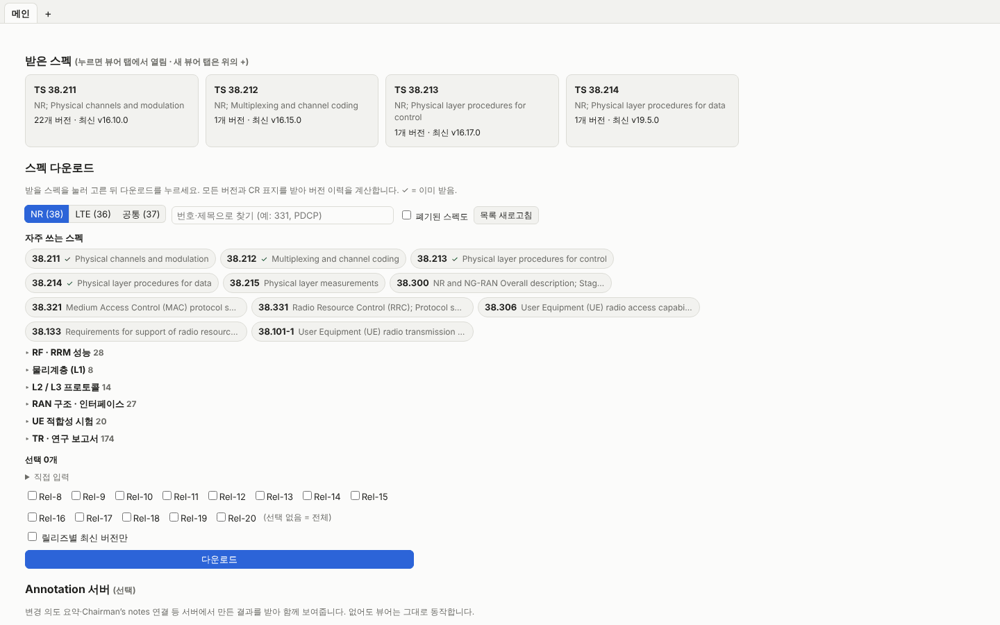

- **받은 스펙**: 이미 받은 스펙 카드. 누르면 뷰어 탭으로 열립니다.
- **스펙 다운로드**
  1. NR(38) / LTE(36) / 공통(37) 시리즈를 고르고, 번호나 제목으로 찾습니다(예: `331`, `PDCP`).
     "자주 쓰는 스펙"과 분류(RF·RRM, 물리계층, L2/L3 …)에서 눌러 여러 개를 고를 수 있습니다. ✓ 는 이미 받은 스펙입니다.
  2. 릴리즈를 고릅니다(아무것도 안 고르면 전체). **릴리즈별 최신 버전만**을 켜면 받는 양이 크게 줄어듭니다.
  3. **다운로드**를 누르면 3GPP archive 에서 모든 버전과 **CR 표지**(Reason / Summary / Clauses affected / WI code)를
     함께 받아 버전 이력을 계산합니다. 진행 상황은 같은 화면 아래에 나옵니다.

> 버전 수가 많은 스펙(예: 38.211 은 22개 버전)은 처음 한 번 변환·계산에 시간이 걸립니다. 이후에는 바로 열립니다.

### 새 버전과 관심 절 변경 알림

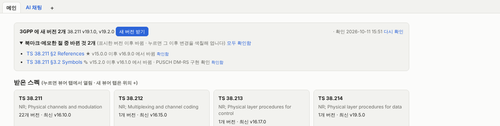

메인 탭 맨 위에 두 가지가 나옵니다.

- **3GPP 에 새 버전 N개**: 받아 둔 스펙에 받은 최신 버전보다 새 버전이 나왔는지 3GPP archive 에서 확인합니다
  (반나절에 한 번, **다시 확인**으로 바로). **새 버전 받기**는 새 버전만 받습니다(예전 버전을 고르지 않고 받은 경우에도
  그 사이 버전을 다시 받지 않음).
- **북마크·메모한 절 중 바뀐 것**: ★ 북마크나 ✎ 메모를 단 절이, 표시할 때 보던 버전 이후에 바뀌었으면 여기 나옵니다.
  누르면 최신 버전에서 그 절이 열리고 "이후 변경 표시"가 표시한 버전으로 맞춰져 **그 뒤에 바뀐 부분만** 색칠됩니다.
  읽었으면 **확인함**: 이제부터는 최신 버전과 비교합니다.

> 구현하는 절에 북마크를 걸어 두고, 분기마다 **새 버전 받기 → 바뀐 관심 절 확인** 순서로 쓰면 됩니다.

## 4. 뷰어 탭 열기

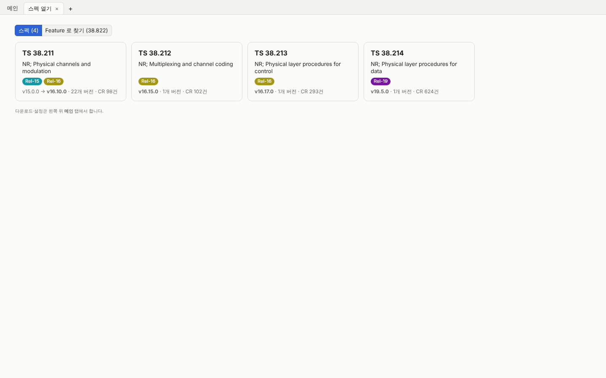

`+` 로 새 뷰어 탭을 열면 받은 스펙이 카드로 나옵니다. 카드에는 릴리즈, 버전 범위, 버전 수, Change history 의 CR 수가
표시됩니다. 위의 **Feature 로 찾기** 는 [14장](#14-feature-로-찾기-tr-38822)에서 설명합니다.

## 5. History 모드: 무엇이 언제 바뀌었나

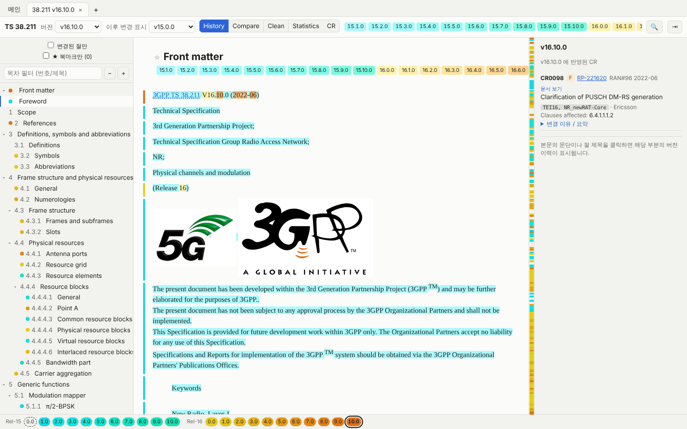

뷰어 탭의 기본 화면입니다. 본문에서 **어느 부분이 어느 버전에서 추가·변경됐는지 단어 단위로 색칠**합니다.

**위쪽 도구 막대**

- **버전**: 보고 있는 버전. Alt+← / Alt+→ 로 이전·다음 버전으로 넘깁니다.
- **이후 변경 표시**: 이 버전 *이후*에 생긴 변경만 색칠합니다. 예를 들어 v16.0.0 으로 두면 Rel-15 변경은 색이 빠지고
  Rel-16 변경만 남습니다.
- **History / Compare / Clean / Statistics / CR**: 보기 모드 전환.
- 오른쪽 끝의 버전 칩(범례): 색과 버전의 대응. 마우스를 올리면 그 버전에 반영된 CR 제목이 나옵니다.
- 🔍 검색(Ctrl+F), ⇤ 오른쪽 정보 패널 열기/닫기.

**색 읽는 법**

- 릴리즈마다 색이 다릅니다(Rel-15 청록, Rel-16 노랑→주황 …). 같은 릴리즈 안에서는 **후반 버전일수록 진합니다**.
- 문단 왼쪽의 세로 막대는 그 문단이 마지막으로 바뀐 버전의 색입니다.
- 절 제목 옆의 버전 칩은 그 절이 바뀐 버전들입니다.
- 다른 절로 옮겨진 문단은 "§X 에서 이동"으로 표시되고 원래 버전 색을 유지합니다.

**왼쪽 목차**

- 점 색은 그 절이 마지막으로 바뀐 버전입니다. **변경된 절만**을 켜면 이후 변경이 있는 절만 남습니다.
- **목차 필터**에 번호나 제목을 입력해 좁히고, `−`/`+` 로 모두 접기·펼치기를 합니다.
- 절 제목의 ☆ 로 북마크하고, **★ 북마크만**으로 북마크한 절만 봅니다.

**아래쪽 버전 막대와 오른쪽 눈금자**

- 맨 아래 버전 막대: 클릭하면 그 버전으로 이동, **Shift+클릭**하면 "이후 변경 표시" 기준 버전으로 지정합니다.
- 본문 오른쪽의 세로 눈금자: 문서 전체에서 변경 위치를 색으로 보여 줍니다. 누르면 그 위치로 이동합니다.

**그 밖에**

- 절 제목 옆 `⧉` 를 누르면 `TS 38.211 §6.3.3.2 (v16.10.0)` 형식의 인용이 복사됩니다.
- 본문의 `clause 5.2.1 of TS 38.213` 같은 참조는 링크입니다. 다른 스펙이면 새 뷰어 탭으로 열리고,
  안 받은 스펙이면 메인 탭에서 다운로드를 제안합니다.

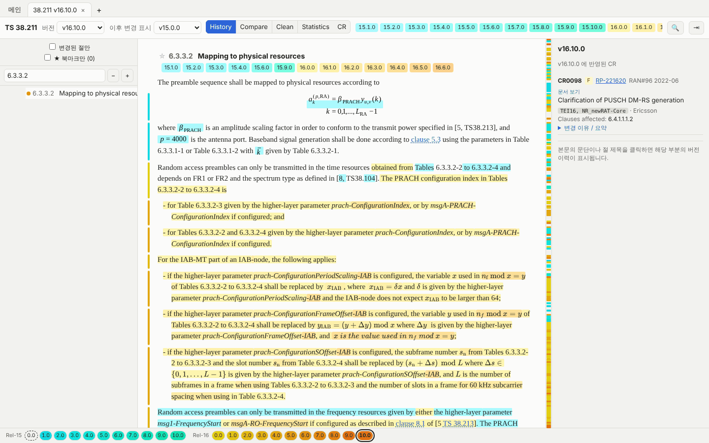

위는 §6.3.3.2 (Mapping to physical resources) 입니다. Rel-15(청록)와 Rel-16(노랑·주황) 변경이 단어 단위로 섞여 보입니다.

## 6. 문단 하나 깊게 보기: 변화 이력·CR·AI 요약

본문에서 **문단을 클릭**하면(파란 테두리) 오른쪽 패널에 그 문단의 모든 정보가 나옵니다.

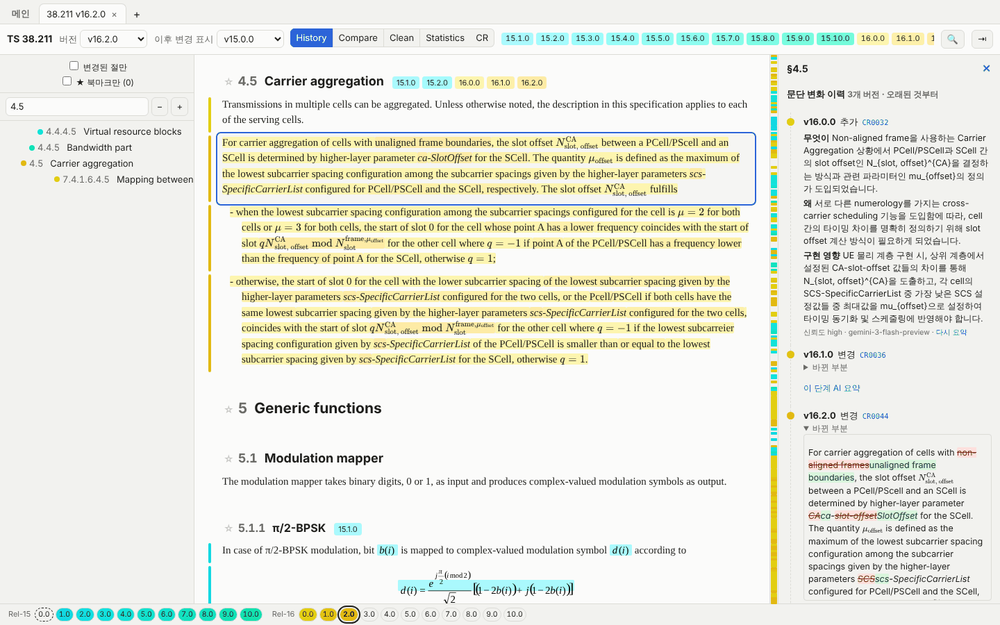

패널은 위에서부터 다음 순서입니다.

<table><tr>
<td valign="top" width="340">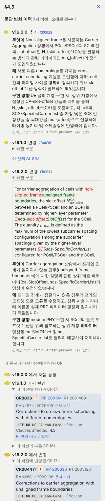</td>
<td valign="top">

**① 문단 변화 이력** — 이 문단이 가졌던 모든 텍스트를 *오래된 버전부터* 단계별로 보여 줍니다.

- 각 단계: 버전, 변화 종류(처음 버전 / 추가 / 변경 / 이동), 그 버전에서 이 절을 고친 CR 번호(누르면 CR 문서 창).
- **바뀐 부분**을 펼치면 바로 앞 단계와의 차이가 <del>삭제</del>·<ins>추가</ins>로 나옵니다.
- 단계마다 **이 단계 AI 요약**을 누르면 그 시점의 변경을 요약합니다. 이미 요약된 단계는 "무엇이 · 왜 · 구현 영향"이
  바로 보이고 **다시 요약**할 수 있습니다.
- 요약 없는 단계가 여럿이면 **요약 없는 N단계 모두 AI 요약** 링크가 위에 나옵니다.
- 요약하면서 그 단계의 CR 을 먼저 통째로 분석(CR 분석)해 저장하고, 문단 요약은 그 분석을 근거로 씁니다.
  같은 CR 이 바꾼 다른 문단은 저장된 CR 분석을 바로 다시 씁니다.

**② 이 문단이 바뀐 버전에 반영된 CR** — 버전별로 그 버전에 반영된 CR 중 이 절을 "Clauses affected"에 적은 CR.

- CR 번호·카테고리(F 수정 / A 미러 / B 추가 / C 변경 / D 편집), Tdoc(RP-…, R1-…) 링크, 회의, WI 코드, 제출 회사.
- **문서 보기**: CR 원문(수정 표시 포함)을 새 창으로 엽니다.
- **변경 이유 / 요약**: 표지의 Reason for change, Summary of change.
- AI 분석이 있는 CR 은 "AI 분석 있음" 표시와 분석 카드가 붙습니다.
- "이 버전의 다른 CR"을 펼치면 같은 버전의 나머지 CR 도 볼 수 있습니다.

</td></tr></table>

<table><tr>
<td valign="top" width="340">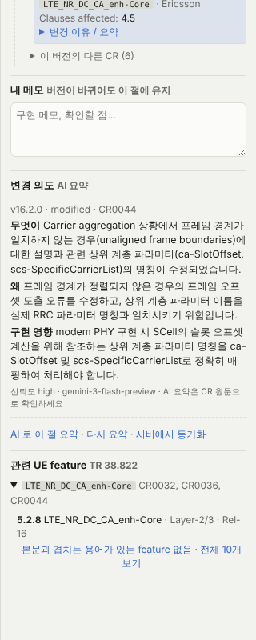</td>
<td valign="top">

**이 절을 인용하는 곳** — 펼치면 이 절을 "clause 6.4.1.1.3" 처럼 인용하는 문단을 같은 스펙과 받은 다른 스펙
(예: 38.214 의 "Clause 6.4.1.1.3 of [4, TS 38.211]")의 최신 버전에서 찾아 보여 줍니다. 이 절이 바뀌면 함께 확인할 곳입니다.
§번호를 누르면 그 절로 이동합니다(다른 스펙이면 그 스펙 탭). AI 채팅도 같은 기능을 써서 "이 절이 바뀌면 어디에 영향?"에 답합니다.

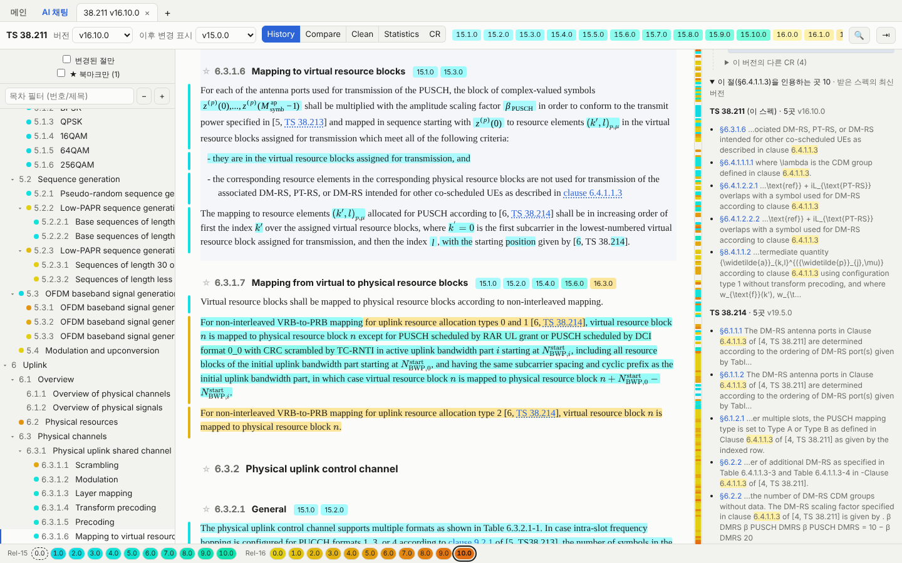

**③ 내 메모** — 구현 메모·확인할 점을 적습니다. 절에 붙어 **버전이 바뀌어도 유지**됩니다.

**④ 변경 의도 AI 요약** — 지금 보고 있는 버전에서 이 문단이 바뀐 이유.

- **무엇이**: 바뀐 내용, **왜**: 동기(CR·회의 합의 근거), **구현 영향**: UE/모뎀 구현에서 할 일.
- 신뢰도(high/medium/low)와 모델 이름이 함께 나옵니다. 근거가 부족하면 신뢰도가 낮게 표시됩니다.
- 근거로 쓴 **회의 합의(Agreement)** 와 **FL summary 발췌**가 있으면 아래에 나오고, "회의록에서 보기"로 원문 위치를
  엽니다([10장](#10-cr-문서-창과-회의-문서-창)).
- **AI 로 이 절 요약**: 이 절의 바뀐 문단 전체를 요약. **서버에서 동기화**: Annotation 서버의 요약을 받아옴.

**⑤ 관련 UE feature (TR 38.822)** — 이 절을 바꾼 CR 의 WI 에 해당하는 38.822 feature.

</td></tr></table>

> **AI 요약은 어디까지 믿어도 되나?** 요약은 CR 표지·CR 원문의 수정 표시·세부 draft CR·회의록 합의·FL summary 만
> 근거로 쓰도록 되어 있고, 근거가 없으면 "자료에 없음"이라고 쓰고 신뢰도를 낮춥니다. 그래도 중요한 판단 전에는
> "문서 보기"로 CR 원문을 확인하세요.

## 7. Compare 모드: 두 버전 비교

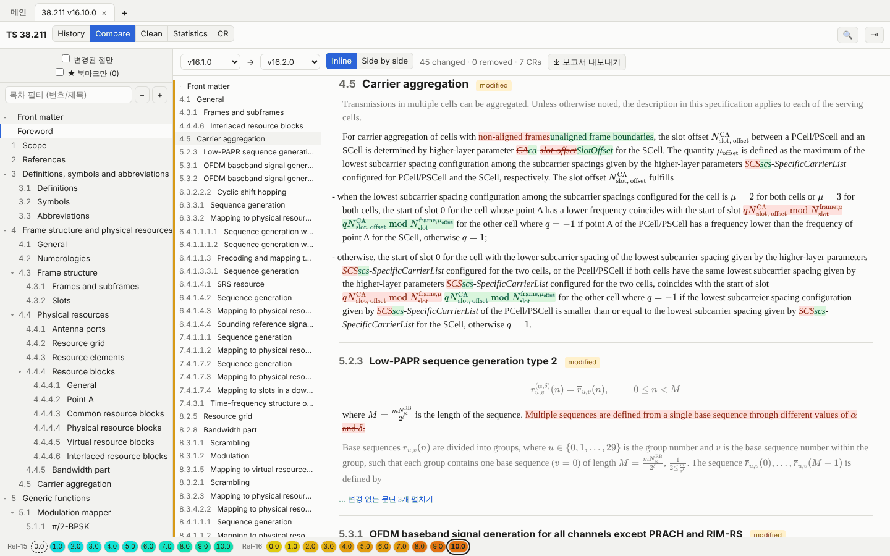

- 위의 두 드롭다운으로 **임의의 두 버전**을 고릅니다(예: v16.1.0 → v16.2.0).
- 요약: "45 changed · 0 removed · 7 CRs" — 바뀐 절 수, 삭제된 절 수, 그 사이 반영된 CR 수.
- 왼쪽 목록은 바뀐 절만 모은 것입니다. 누르면 그 절로 이동합니다.
- 바뀌지 않은 문단은 접혀 있습니다("변경 없는 문단 N개 펼치기").
- **Inline**: 한 본문에 <del>삭제</del>/<ins>추가</ins>를 함께 표시. 수식·표 안의 변경도 표시됩니다.
- **Side by side**: 왼쪽 이전 버전, 오른쪽 새 버전.

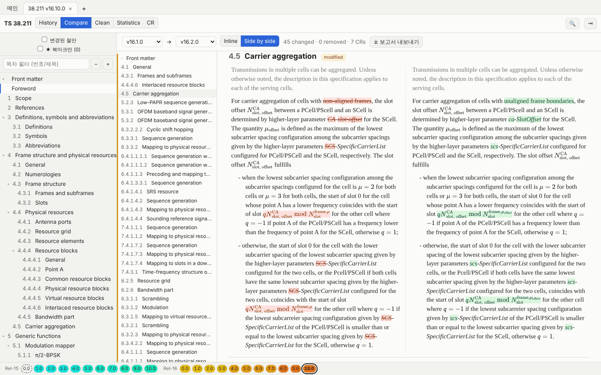

- **⬇ 보고서 내보내기**: 비교 결과를 HTML 파일로 저장해 메일·위키에 공유할 수 있습니다.
- **✦ AI 릴리즈 노트**: 두 버전 사이의 CR 을 AI 가 정리합니다 — 개요, **WI 별 기능 추가·변경**(CR·절), **주요 수정**,
  **구현 영향**. 한 번 만들면 저장되고, **⧉ Markdown 복사** / **⬇ HTML** 로 내보낼 수 있습니다. CR 분석이 있으면 더 정확합니다.

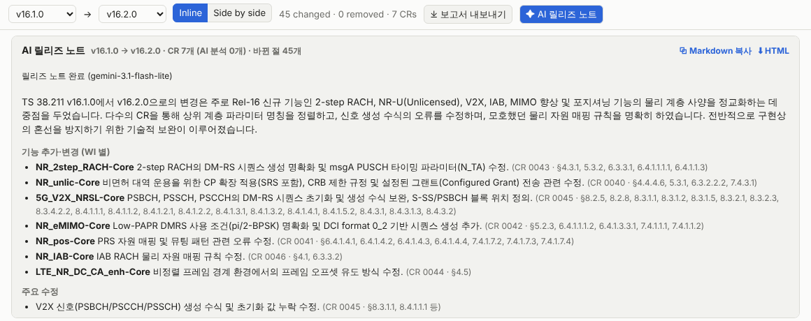
- Statistics 모드의 막대를 눌러도 그 버전과 이전 버전의 Compare 로 바로 옵니다.

> 큰 적합성 스펙(38.523-1 등)은 한 번 비교에 십여 초 걸릴 수 있습니다. 같은 비교를 다시 열면 바로 나옵니다.

## 8. Clean·Statistics 모드

**Clean** — 색칠 없이 그 버전 본문만 읽기 좋게 보여 줍니다. 오른쪽 패널에는 그 버전에 반영된 CR 이 나옵니다.

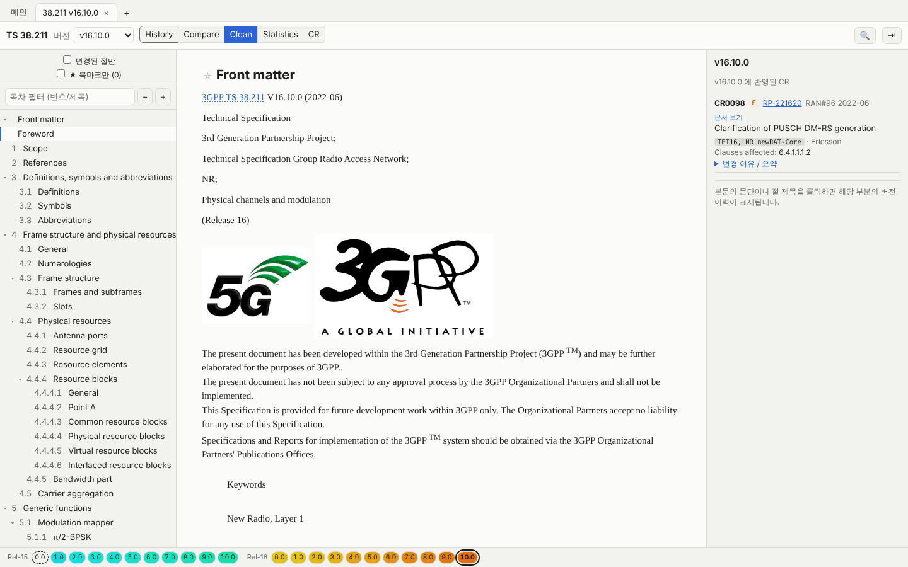

**Statistics** — 스펙이 어떻게 변해 왔는지 한눈에 봅니다.

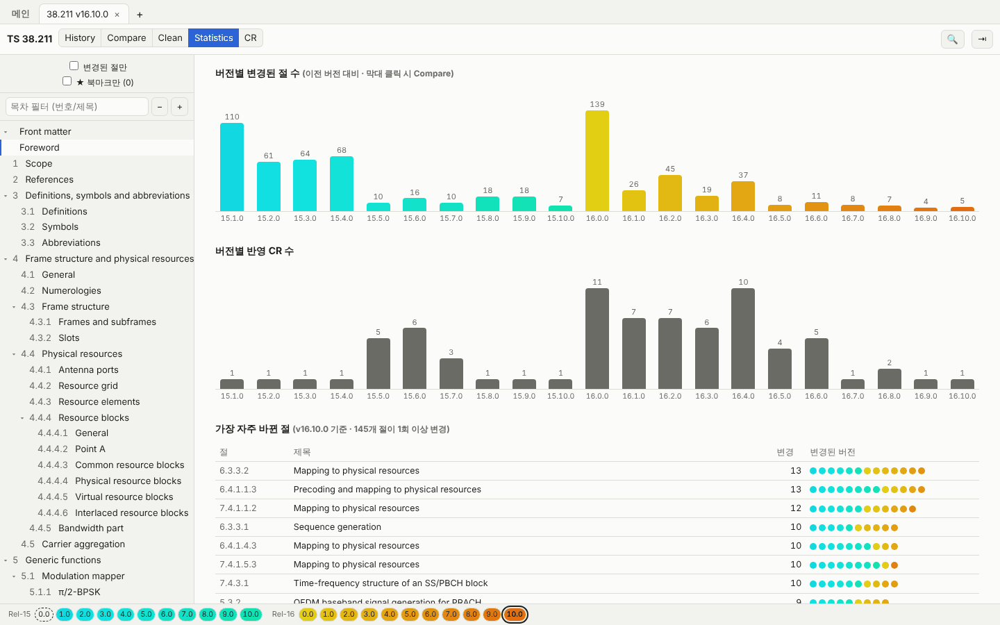

- **버전별 변경된 절 수**: 막대를 누르면 그 버전의 Compare 로 이동.
- **버전별 반영 CR 수**.
- **가장 자주 바뀐 절**: 변경 횟수 순. 점은 바뀐 버전들(색 = 버전). 행을 누르면 History 의 그 절로 이동.

## 9. CR 모드: CR 전체 목록

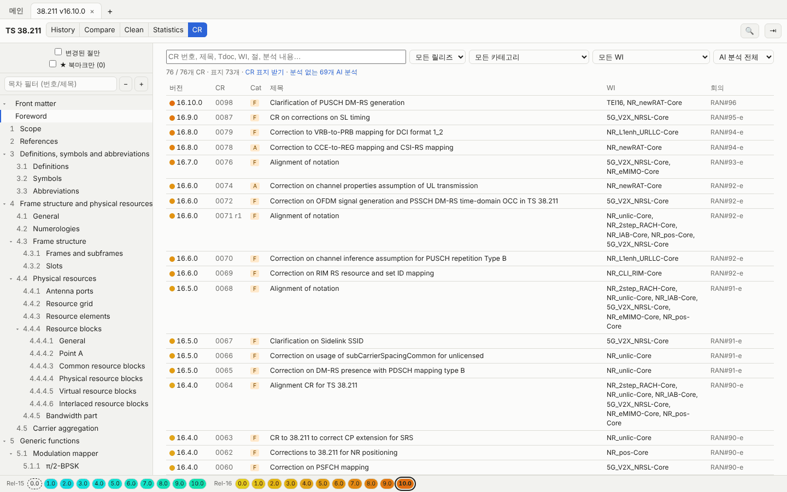

스펙의 Change history 에 있는 **CR 전체를 한 표**로 봅니다.

- **걸러 보기**: 텍스트(CR 번호, 제목, Tdoc, WI, 절, AI 분석 내용), 릴리즈, 카테고리, **WI**, AI 분석 유무.
- 상태 줄: "76 / 76개 CR · 표지 73개". 표지가 없는 CR 이 있으면 **CR 표지 받기**로 받습니다.
- **분석 없는 N개 AI 분석**: 지금 걸러진 CR 중 표지가 있고 AI 분석이 없는 것을 **하나씩 차례로** 분석합니다.
  진행률과 **중지** 버튼이 나옵니다. (예: WI 하나를 골라 그 CR 을 전부 분석)
- 행 왼쪽 점은 그 CR 이 반영된 버전의 색, 오른쪽 **AI** 표시는 분석이 있는 CR 입니다.
- **⬇ CSV (Excel)**: 지금 걸러진 목록을 Excel 에서 바로 열리는 CSV 로 저장합니다. 표지(릴리즈, WI, 바뀐 절, Reason,
  Summary)와 AI 요약·회의 결정·구현 영향, 3GPP 포털 링크가 들어갑니다(예: WI 하나로 걸러 보고서용 표 만들기).

행을 누르면 펼쳐집니다.

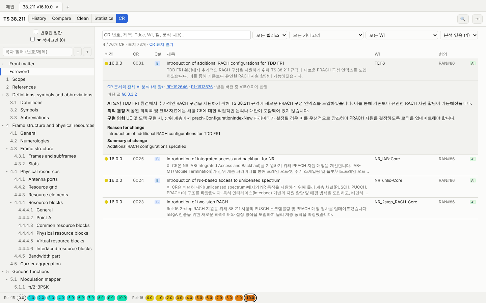

- **CR 문서와 전체 AI 분석 (새 창)**, RP-/R1- Tdoc 링크, "받은 버전 중 v16.0.0 에 반영".
- **바뀐 절**: §번호를 누르면 History 의 그 절로 이동합니다.
- **AI 요약 / 회의 결정 / 구현 영향**(분석이 있을 때), 표지의 Reason / Summary.

## 10. CR 문서 창과 회의 문서 창

CR 의 "문서 보기"를 누르면 앱 안의 별도 창으로 CR 원문이 열립니다.

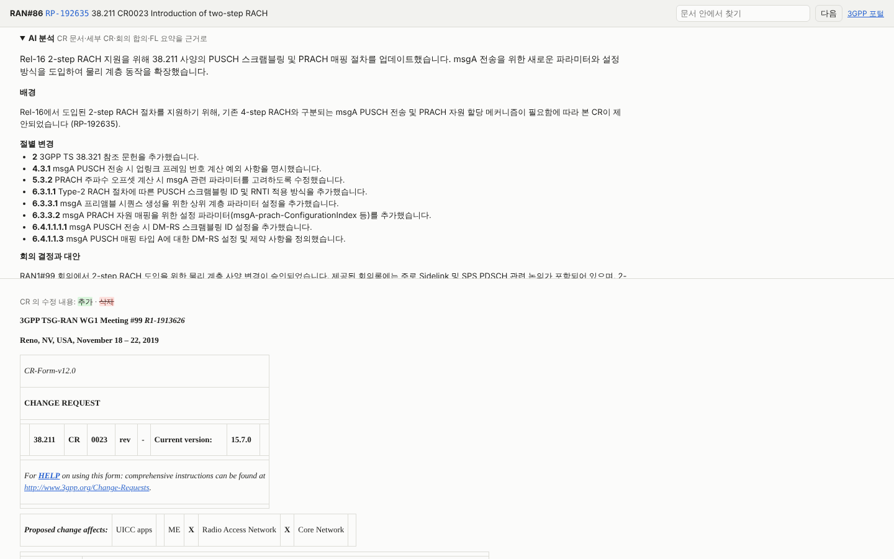

- 위쪽 **AI 분석**: 요약, 배경, 절별 변경, 회의 결정과 대안, 구현 영향. 분석이 없으면 **AI 로 이 CR 분석**,
  있으면 **다시 분석** 버튼이 있습니다.
- **분석에 쓴 근거**를 펼치면 세부 draft CR, 회의 합의(Agreement 원문), FL summary 발췌가 나옵니다.

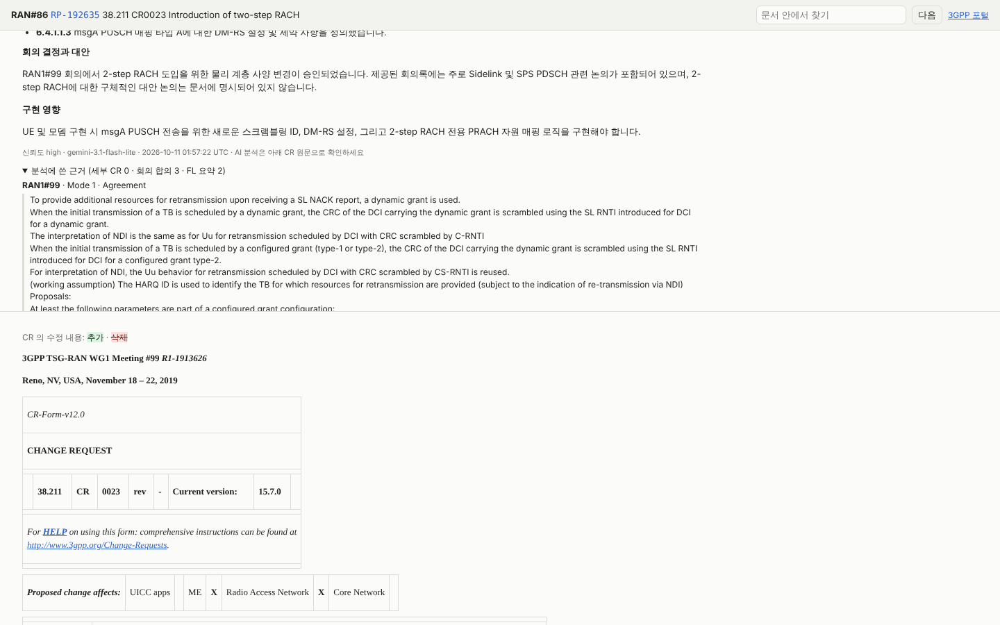

- 아래쪽은 CR 원문(표지 + 바뀐 절)입니다. Word 의 수정 표시가 앱의 diff 와 같은 <ins>추가</ins>·<del>삭제</del>로 보입니다.

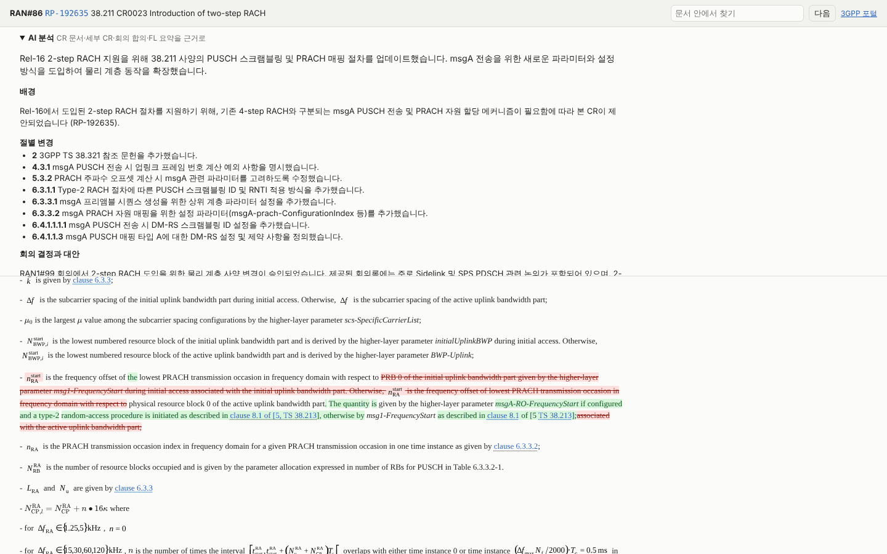

- 오른쪽 위: **문서 안에서 찾기**, **3GPP 포털**(CR 페이지).

근거의 **회의록에서 보기** / **문서 보기**는 WG 회의 문서를 같은 방식의 창으로 열고, 해당 합의나 문단 위치로 바로
이동해 그 부분을 강조 표시합니다. 문서 안의 `R1-xxxxxxx` 링크는 같은 회의의 그 문서를 또 새 창으로 엽니다.

| 회의록 (Meeting report) | FL / Moderator summary |
|---|---|
| 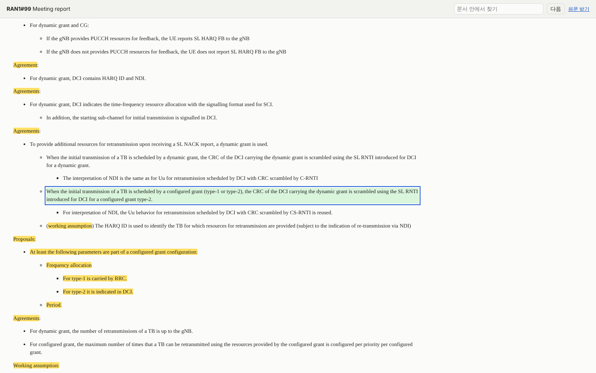 | 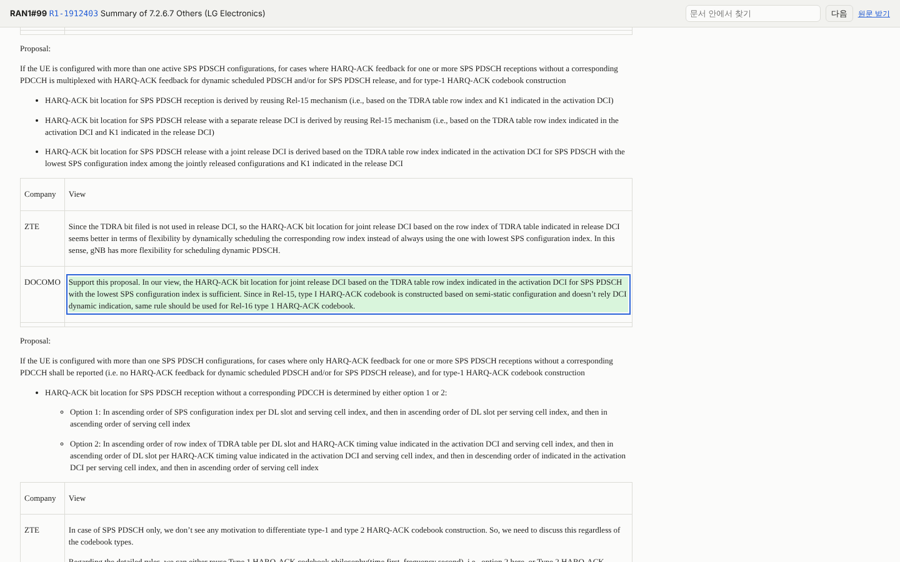 |

> 회의 문서는 처음 열 때 3GPP FTP 에서 받아 변환하므로 몇 초~수십 초 걸립니다. 한 번 받은 문서는 라이브러리에
> 캐시됩니다.

## 11. WI(Work Item) 단위 요약

CR 모드에서 **WI 드롭다운**으로 WI 하나를 고르면 표 위에 그 WI 의 요약 패널이 나옵니다.

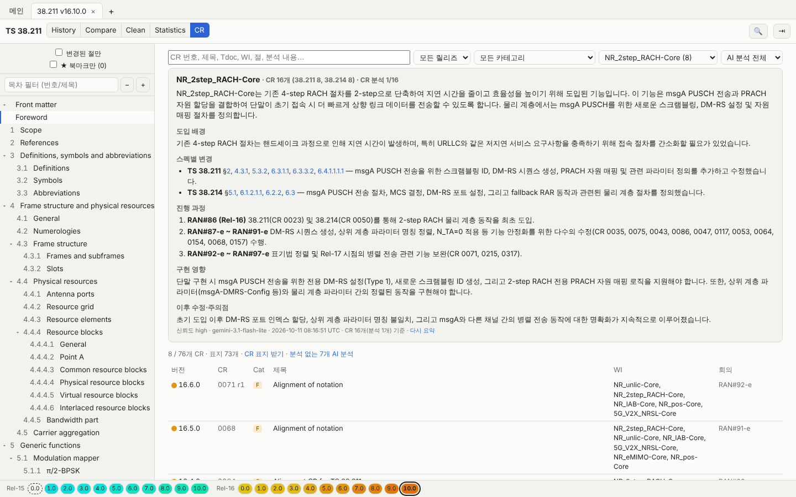

- 머리줄: **받은 모든 스펙**에 걸친 그 WI 의 CR 수(스펙별)와 CR 분석 수.
- **AI 로 이 WI 요약**을 누르면 CR 표지와 저장된 CR 분석을 모아 기능 전체를 정리합니다.
  - **개요 / 도입 배경**
  - **스펙별 변경**: 스펙별 절 번호 — 지금 스펙의 절은 그 절로, 다른 스펙의 절은 새 뷰어 탭으로 엽니다.
  - **진행 과정**: 처음 도입한 CR(회의) → 이후 수정 CR 순.
  - **구현 영향 / 이후 수정·주의점**
- 요약 뒤에 그 WI 의 CR 이 늘었으면 패널에 표시되고 **다시 요약**할 수 있습니다.

> 더 정확하게: WI 를 고른 상태에서 먼저 **분석 없는 N개 AI 분석**으로 CR 분석을 만든 뒤 WI 요약을 하세요.
> (CR 분석은 지금 보고 있는 스펙의 CR 만 대상이므로, 다른 스펙도 그 스펙 탭에서 같은 방법으로 분석합니다.)

## 12. AI 채팅: 받은 자료로 질문에 답하기

상단의 **AI 채팅** 탭에서 스펙에 대해 자유롭게 질문합니다. AI 가 받아 둔 자료를 직접 찾아 읽고 **출처를 달아** 답합니다.

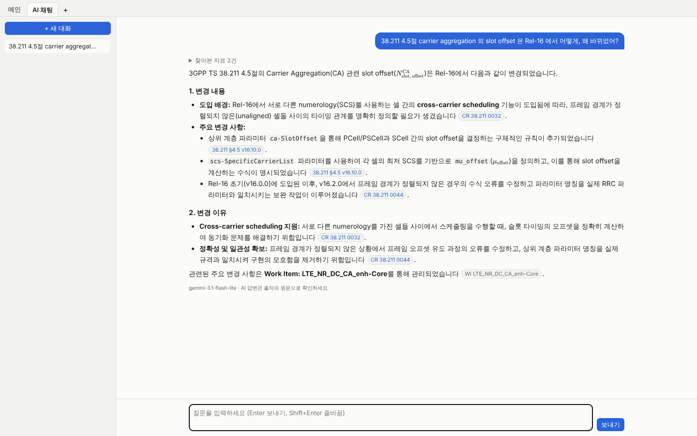

- AI 가 쓰는 자료: 받은 스펙 본문(모든 버전), 절·문단 변경 이력, CR 표지와 CR 분석, 회의 합의, WI 요약.
  모델이 원래 알던 지식이 아니라 **이 자료만** 근거로 답하도록 되어 있고, 자료에 없으면 없다고 답합니다.
- 답을 만드는 동안 무엇을 찾아보는지(검색, 절 읽기, 변경 이력, 버전 비교, CR, WI)가 단계별로 보이고,
  답 위의 **찾아본 자료 N건**을 펼치면 다시 볼 수 있습니다.
- 답이 오래 걸리거나 질문을 잘못 보냈으면 **■ 중지**를 누르세요. 지금 진행 중인 AI 요청이 끝나면 멈추고,
  대화에는 "(답변 중지됨)"이 남습니다(다음 질문의 문맥에는 들어가지 않음).
- **출처 칩**: `38.211 §4.5 v16.10.0` 을 누르면 뷰어 탭에서 **그 버전의 그 절**이 열리고, `CR 38.211 0044` 를 누르면
  CR 문서 창이 열립니다. 점선 칩은 AI 가 언급했지만 찾아본 자료에는 없는 출처입니다.
- 같은 대화에서 이어서 물으면 앞의 질문과 답을 기억합니다("그 CR 들이 반영된 회의는?"). 왼쪽 목록에서 지난 대화를
  다시 열거나 지울 수 있고, 대화는 라이브러리에 저장됩니다.
- 질문은 한국어로 해도 됩니다. AI 가 3GPP 영어 용어로 바꿔 검색합니다.
- "38.211 v16.1.0 에서 v16.2.0 으로 바뀐 것 정리해줘" 같은 **버전 사이 변경** 질문에는 그 사이 CR·바뀐 절·저장된
  릴리즈 노트를 찾아 답합니다.
- **내보내기**: 답 아래의 **⧉ Markdown 복사**(메일·메신저·위키에 붙여넣기)와 **⬇ HTML**(질문+답+출처 목록, CR 은
  3GPP 포털 링크), 대화 위의 **⬇ 대화 내보내기 (HTML)** 로 대화 전체를 한 파일로 저장합니다.

**문단에 대해 질문하기** — 뷰어에서 문단을 클릭하고 오른쪽 패널 위의 **💬 AI 에게 질문**을 누르면, 그 문단을
맥락으로 새 대화가 열립니다("이 문단이 왜 바뀌었는지 설명해줘").

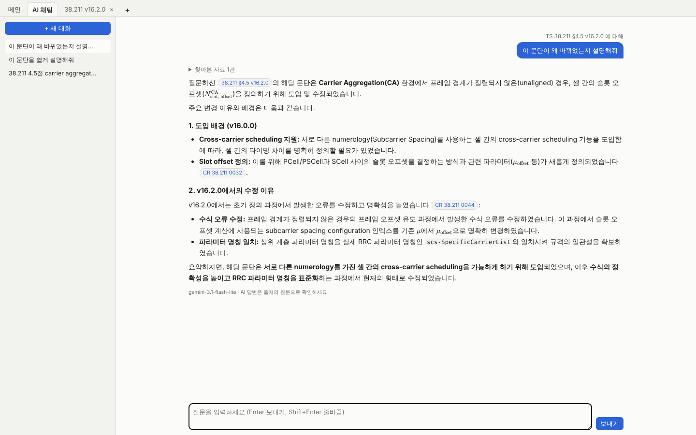

> 사내 LLM 서버가 도구 호출(function calling)을 지원하지 않으면, 자동으로 "검색 결과를 모아 한 번에 답하는" 방식으로
> 바뀝니다(답 아래에 "검색 결과 기반"으로 표시). 도구 호출을 지원하는 서버(vLLM 의 `--enable-auto-tool-choice` 등)에서
> 답이 더 정확합니다. 질문 하나에 LLM 요청이 여러 번 들어가 수십 초 걸릴 수 있습니다.

## 13. 검색: 스펙 전체 검색과 문구 이력

**Ctrl+F** (또는 🔍) — 지금 버전 전체를 검색합니다(아직 화면에 안 불러온 절도 포함).

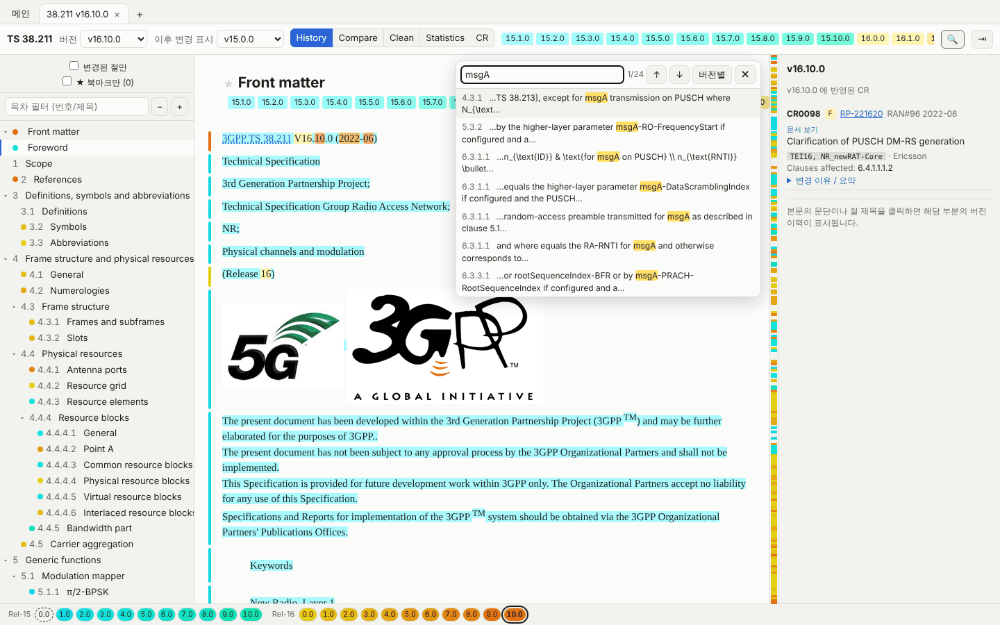

- Enter / Shift+Enter 로 다음·이전 결과, 결과를 누르면 그 위치로 이동합니다.

**버전별** 버튼 — 입력한 문구(단어 순서 그대로)가 **모든 버전에서 어디에 있었는지** 보여 줍니다.

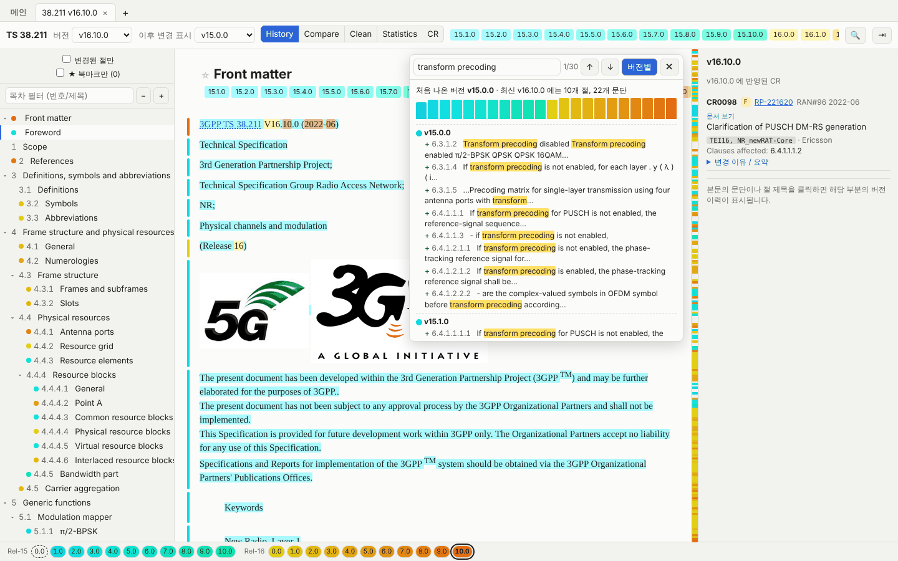

- 처음 나온 버전, 최신 버전의 절·문단 수, 버전별 절 수 막대(색 = 버전).
- 버전마다 그 문구가 **새로 생긴 절(+, 스니펫)** 과 **사라진 절(−)**.
- 항목을 누르면 **그 버전으로 바꾸고 그 절로 이동**합니다(사라진 절은 사라지기 직전 버전으로).
- 예: `transform precoding` 은 v15.0.0 에 처음 나오고, v15.1.0 에서 §6.4.1.1.1 이 §6.4.1.1.1.1/§6.4.1.1.1.2 로 나뉜 것이 보입니다.

**Ctrl+P 명령 팔레트** — 절 번호·제목, 버전, 모드, 다른 스펙으로 바로 이동합니다.

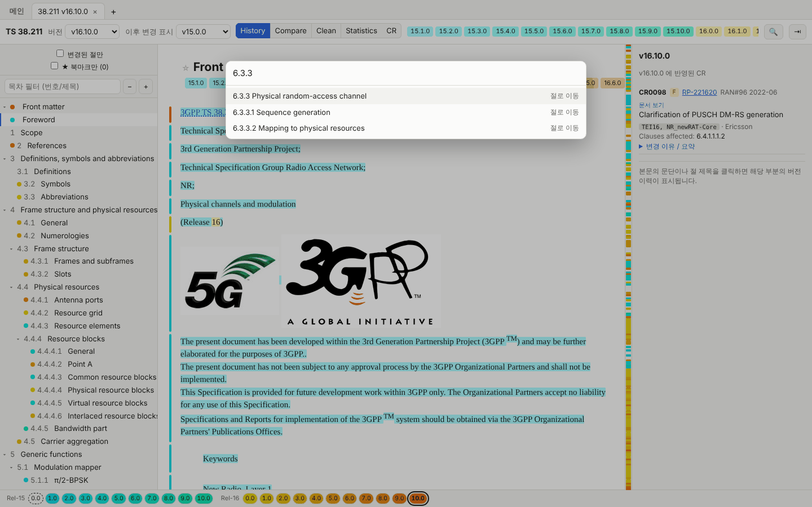

## 14. Feature 로 찾기 (TR 38.822)

새 뷰어 탭에서 **Feature 로 찾기**를 누르고 feature 번호·이름·WI 로 찾습니다(예: `2-1`, `PDSCH`, `NR_IAB`, `2-step RACH`).
feature 를 고르면 **받은 모든 스펙에서 그 feature 와 관련된 절**을 스펙별로 모아 보여 줍니다.

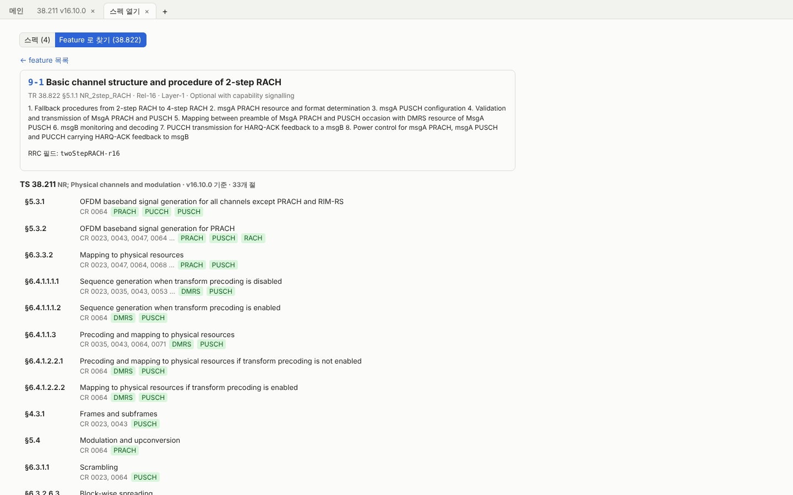

- 위: feature 설명(38.822 의 구성 요소, RRC 필드 이름 등).
- 아래: 스펙별 관련 절. 근거는 **그 WI 의 CR 이 고친 절**(CR 번호)과 **본문에 RRC 필드 이름이 나오는 절**이며,
  겹치는 용어(초록 태그)가 많은 순입니다. 절을 누르면 그 스펙의 그 절이 열립니다.
- 38.822 를 아직 받지 않았으면 이 화면에 **38.822 받기** 버튼이 나옵니다. 한 번 받으면 됩니다.

## 15. AI(LLM) 설정과 사용 요령

AI 기능은 **선택**입니다. 설정하지 않아도 버전 이력·CR·회의 문서 보기는 모두 동작합니다.

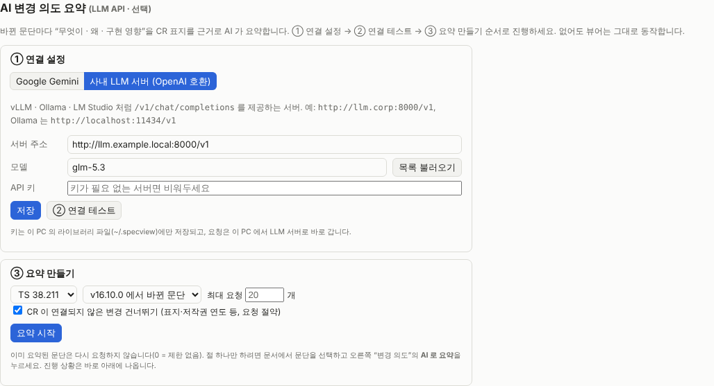

**① 연결 설정** (메인 탭)

- **사내 LLM 서버 (OpenAI 호환)**: vLLM·Ollama·LM Studio 처럼 `/v1/chat/completions` 를 제공하는 서버.
  - 서버 주소 예: `http://llm.corp:8000/v1`, 모델 예: `glm-5.3`. **목록 불러오기**로 서버의 모델을 고를 수 있습니다.
  - 키가 필요 없는 서버면 API 키는 비워 둡니다.
- **Google Gemini**: API 키를 넣습니다.
- 키는 이 PC 의 라이브러리 파일에 Windows 계정으로 암호화(DPAPI)해서 저장됩니다. 다른 사용자나 다른 PC 로 복사한 파일에서는 읽히지 않으니, 그때는 키를 다시 넣으세요. 요청은 이 PC 에서 LLM 서버로 바로 갑니다.

**② 연결 테스트** — 짧은 요청 하나로 주소·키·모델을 확인합니다.

**③ 요약 만들기** — 스펙·버전을 고르고 그 버전에서 바뀐 문단을 한꺼번에 요약합니다.
- **최대 요청** 수로 한 번에 보내는 요청을 제한합니다. 이미 요약된 문단은 다시 요청하지 않습니다.
- "CR 이 연결되지 않은 변경 건너뛰기"를 켜면 표지·저작권 연도 같은 의미 없는 변경을 건너뜁니다.

**④ 전체 분석 (퇴근할 때 걸어 두기)** — 받은 스펙의 **모든 버전**을 한 번에 분석합니다.

1. 분석할 스펙을 고릅니다(기본: 전부). 옵션: CR 이 연결되지 않은 변경 건너뛰기, 남은 CR 도 모두 분석, 마지막에 모든 WI 요약.
2. **전체 분석 시작** → 다음 순서로 진행합니다.
   - [1/3] 버전마다(최신 버전부터) 바뀐 문단을 요약합니다. 관련 CR 분석도 이때 함께 만듭니다.
   - [2/3] 아직 분석이 없는 CR(표지가 있는 것)을 분석합니다.
   - [3/3] 모든 WI 를 요약합니다.
3. 진행 상황(지금 버전, 경과 시간, 새로 만든 개수)이 같은 자리에 나오고, **중지**로 언제든 멈출 수 있습니다.

- 10개 요청마다 바로 저장하므로 중간에 멈추거나 앱을 꺼도 잃는 것이 거의 없고, **다시 시작하면 이미 한 것은
  건너뛰고 이어서** 합니다.
- LLM 서버가 응답하지 않으면 1분, 2분, … 늘려 가며 기다렸다 다시 시도하고(약 30분), 그래도 안 되면 멈춥니다.
  서버는 응답하는데 특정 문단만 계속 실패하면 그 문단은 건너뛰고 다음 실행 때 다시 시도합니다.
- 도는 동안 Windows 절전을 막습니다(끝나면 원래대로). 단, 노트북 덮개를 닫으면 절전되므로 열어 두거나
  전원 설정을 확인하세요.
- 그동안 다른 AI 버튼은 "AI 작업이 이미 진행 중"으로 막힙니다.

**분석 현황** — ④ 아래의 "분석 현황"을 펼치면 아침에 밤새 어디까지 됐는지 한눈에 봅니다. 스펙별(누르면 버전별)로
바뀐 문단 수와 그중 CR 이 연결된 수, **문단 요약 진행률**, **CR 분석 진행률**, **WI 요약 진행률**, 그리고 마지막 전체
분석의 시작·끝 시각과 결과(만든 개수·실패 수)가 나옵니다. 앱을 다시 켜도 남아 있고, 분석이 도는 동안 자동으로 갱신됩니다.

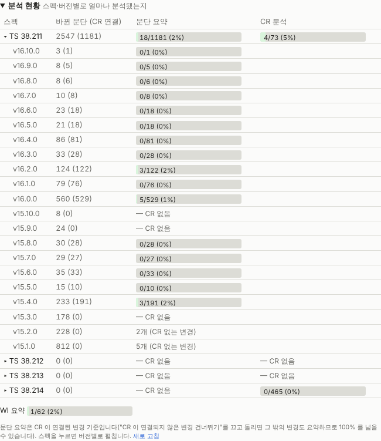

**AI 가 만드는 것과 저장 위치**

| 종류 | 만드는 곳 | 근거 | 다시 쓰임 |
|---|---|---|---|
| 문단 요약(변경 의도) | 문단 패널, ③ 요약 만들기 | 바뀐 단어, CR 표지·draft CR, 회의 합의, FL summary, CR 분석 | 같은 문단 |
| CR 분석 | 문단 요약 시 자동, CR 모드, CR 문서 창 | CR 원문 수정 표시, 세부 CR, 회의 합의, FL summary | 그 CR 이 바꾼 모든 문단 |
| WI 요약 | CR 모드 WI 선택 | 그 WI 의 모든 CR 표지와 CR 분석 | — |

모두 라이브러리에 저장되어 앱을 다시 켜도 그대로 보입니다.

**추천 순서**

0. (시간이 있으면) **④ 전체 분석**을 밤새 돌려 두면 아래 단계가 모두 미리 채워집니다.
1. 관심 있는 WI 를 CR 모드에서 고르고 → **분석 없는 N개 AI 분석** (스펙마다)
2. **AI 로 이 WI 요약** 으로 기능 전체 그림
3. 궁금한 문단을 클릭해 **문단 변화 이력**의 단계별 요약으로 세부 확인

## 16. 단축키

| 키 | 동작 |
|---|---|
| Ctrl+T | 새 뷰어 탭 |
| Ctrl+W | 지금 뷰어 탭 닫기 |
| Ctrl+F | 스펙 전체 검색 (Enter 다음, Shift+Enter 이전, Esc 닫기) |
| Ctrl+P | 명령 팔레트 (절·버전·모드·스펙 이동) |
| Alt+← / Alt+→ | 이전 / 다음 버전 |
| 아래 버전 막대 Shift+클릭 | "이후 변경 표시" 기준 버전 지정 |

## 17. 자주 묻는 질문·문제 해결

**Q. 색칠이 너무 많아서 보기 힘들어요.**
"이후 변경 표시"를 최근 버전으로 올리면 그 이후 변경만 남습니다. 색 없이 읽으려면 Clean 모드를 쓰세요.

**Q. 어떤 문단의 CR 이 "연결된 CR 없음"으로 나와요.**
CR 표지의 "Clauses affected"에 그 절이 적혀 있지 않은 경우입니다(표지가 상위 절만 적는 경우 등). 같은 버전의
다른 CR 은 패널의 "이 버전의 다른 CR"에서 볼 수 있습니다. 표지를 아직 안 받았다면 CR 모드의 **CR 표지 받기**를 누르세요.

**Q. AI 버튼이 안 보여요.**
메인 탭 ① 연결 설정을 저장하세요. Gemini 는 API 키가 있어야 버튼이 나옵니다. 사내 서버는 주소만 있어도 됩니다.

**Q. "AI 작업이 이미 진행 중입니다" 오류가 나요.**
AI 요청은 서버 부담을 줄이려고 한 번에 하나씩만 실행합니다. 진행 중인 작업이 끝난 뒤 다시 누르세요.

**Q. 회의 문서나 CR 원문이 안 열려요.**
3GPP FTP 에 접속할 수 있어야 합니다. 사내망이면 `HTTPS_PROXY` 를 설정하고 앱을 다시 실행하세요.

**Q. 구형 스펙(.doc)이 변환되지 않아요.**
Word 또는 LibreOffice 가 설치되어 있어야 합니다.

**Q. 데이터를 다른 PC 로 옮기거나 백업하려면?**
`%USERPROFILE%\.specview` 폴더를 통째로 복사하면 됩니다(받은 스펙, CR, AI 분석, 메모 모두 포함).
API 키는 Windows 계정으로 암호화되어 있어 다른 PC·다른 계정에서는 읽히지 않으니, 옮긴 뒤 ① 에서 키를 다시 넣으세요.

**Q. 오류가 났는데 원인을 알고 싶어요.**
메뉴(Alt) **Help → 로그 폴더 열기** 에서 `specview.log` 를 보세요. 다운로드·변환·AI 작업의 실패와 원인이 기록됩니다.
문의할 때 이 파일을 같이 보내 주면 빠릅니다(API 키는 기록되지 않습니다).

**Q. "백엔드가 종료되었습니다" 창이 떠요.**
아주 큰 스펙을 변환하다 메모리가 부족했거나 보안 프로그램이 프로세스를 멈춘 경우입니다. **다시 시작**을 누르면
이어서 쓸 수 있고(열려 있던 탭은 닫힘), 받던 다운로드는 다시 누르면 받은 것은 건너뛰고 이어서 받습니다.
